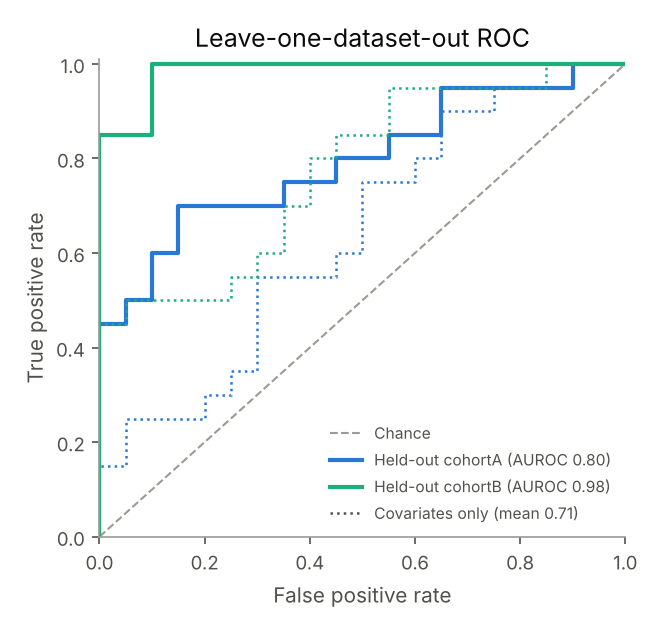
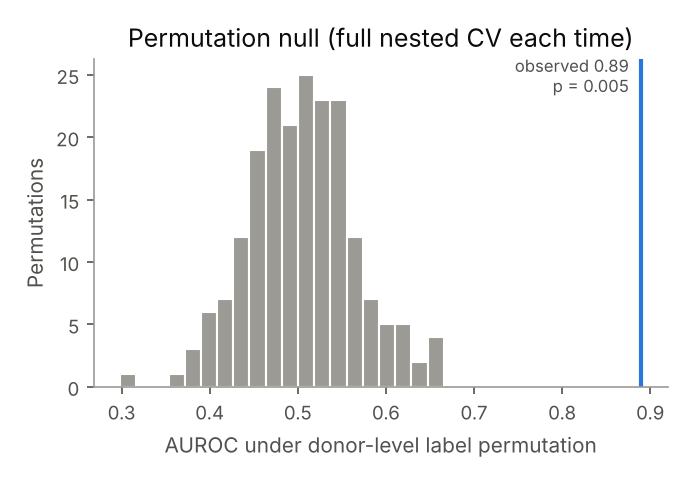
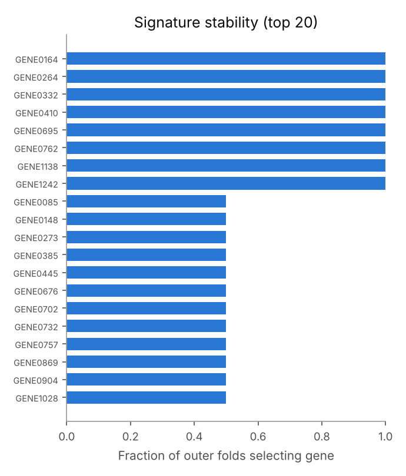
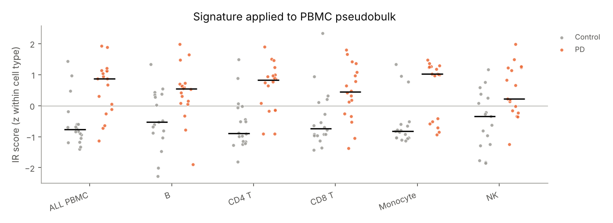

# A transferable PBMC insulin-resistance score, applied to Parkinson's disease single-cell data

[](https://github.com/<your-username>/pbmc-ir-signature/actions)

A small, end-to-end computational project:

1. **Train** a transcriptomic classifier of insulin resistance (IR) on bulk PBMC cohorts with clinical IR labels.
2. **Validate** it with nested, donor-grouped cross-validation, leave-one-dataset-out (LODO) where several cohorts exist, a donor-level permutation null, and a covariates-only baseline.
3. **Transfer** it to Parkinson's disease (PD) PBMC single-cell data through donor × cell-type pseudobulk, and test whether scores differ between PD and controls after adjusting for age, sex and cell composition.

> A PBMC score is at most a *peripheral proxy*. It is not a measure of brain insulin resistance, and an association with PD would not show cause.

## Why these design choices

| Problem | What the pipeline does |
|---|---|
| Training and target data come from different platforms (microarray intensities vs scRNA-seq counts) | **Within-sample gene ranks** as features. They are unchanged by any monotone transform and need no cross-sample normalisation, so there is nothing to leak between folds. |
| Small cohorts make optimistic estimates easy | **Nested CV**: gene ranking, top-k selection (Welch t), scaling and the elastic-net hyper-parameter search are refitted inside every outer training fold. `tests/test_core.py::test_nested_cv_is_honest_on_pure_noise` shows that selecting genes before CV gives AUROC > 0.9 on pure noise, while this pipeline stays near 0.5. |
| Several samples per person (cell types, visits) | Outer and inner splits are **grouped by donor**, the bootstrap CI resamples donors, and permutations shuffle labels **between donors**. |
| Does it generalise to a new cohort? | **LODO** outer loop when ≥ 2 training datasets are given. The primary metric is the mean AUROC *within* each held-out dataset. |
| Is it more than BMI/age/sex? | A **covariates-only baseline** under the same splits, plus a test of the out-of-fold score's added value beyond the covariates (logistic regression). |
| A blood signature can just track cell composition | Pseudobulk keeps **per-cell-type** profiles, and donor cell-type proportions can enter the association model as covariates (e.g. `prop_Monocyte`). |
| Target genes missing | The model is trained on genes **detected in the target cohort** (`--restrict-genes`), and scoring refuses data with < 90 % coverage. |

## Pipeline

```text
GEO series matrix ──prepare-geo──► genes × samples (bulk, IR labels) ─┐
                                                                      ├─► train ──► model.joblib, metrics, ROC, permutation null, gene stability
scRNA-seq (h5ad or Seurat .rds) ──pseudobulk──► donor × cell type ───┤      (restricted to genes detected in the target)
                                        └─► detected_genes.txt ───────┘
                                                                      └─► apply ──► scores, PD vs control tests per cell type
```

Python package `irsig` (`src/irsig/`): `geo.py`, `pseudobulk.py`, `features.py`, `model.py`, `score.py`, `plotting.py`, `simulate.py`, `cli.py`. R: `scripts/seurat_pseudobulk.R` pseudobulks a large Seurat or SingleCellExperiment `.rds` directly, without converting it to h5ad. CI checks that its output is identical to the Python implementation.

## Quick start (synthetic data, about 4 minutes)

```bash
python -m venv .venv && source .venv/bin/activate
pip install -e ".[dev]"
pytest -q                                   # 13 tests: leakage, grouping, LODO, R/Python parity, end-to-end
irsig demo --out results/demo --n-perm 200
```

The demo simulates two bulk cohorts on different platforms (a microarray-like and an RNA-seq-like) and a 36-donor PD/control single-cell dataset. In the simulation an IR programme acts mainly in monocytes, and PD donors are IR more often (an assumption of the simulation, not a claim). The figures below come from **synthetic data**. They show what the pipeline produces and are not findings.

| | |
|---|---|
|  |  |
|  |  |

On the synthetic data, the held-out microarray cohort scores lower than the held-out RNA-seq cohort (AUROC 0.80 vs 0.98). Even rank features do not remove probe-specific affinity effects, which is the reason to validate across platforms.

## Real data

See [`docs/real_data.md`](docs/real_data.md) for step-by-step commands. In short:

- **Training:** a bulk PBMC cohort with IR phenotypes, e.g. GEO GSE87005 (PBMC transcriptomes of 10 insulin-resistant vs 10 insulin-sensitive healthy adults). Add a second labelled cohort to enable LODO.
- **Application:** a multi-donor PD PBMC scRNA-seq dataset with raw counts, donor IDs and cell-type labels, e.g. Zenodo record 14372434 (10 controls, 14 sporadic PD; Seurat `.rds`).

## Results on real data

_To be filled after running `docs/real_data.md`. Report: the CV scheme, primary AUROC with its donor-bootstrap 95 % CI, permutation p, the covariate baseline, gene coverage in the PD data, and per-cell-type PD-vs-control effects with FDR. With about 20 training donors, expect wide intervals._

## Limitations

- Training labels come from small cohorts. A 20-donor extreme-phenotype design overestimates how well the score would work in the general population.
- Rank features reduce platform effects but do not remove them, as the synthetic microarray cohort shows. ComBat or reference-based alignment would be the next comparison to run.
- A signature trained on bulk PBMC partly encodes cell composition. Per-cell-type scores and proportion covariates make this visible but do not fully separate the two.
- PD cohorts differ in medication (e.g. levodopa), diet and metabolic comorbidity. Without these covariates, a PD/control difference cannot be read as IR.
- No link to central measures (intranasal-insulin fMRI/EEG, FDG-PET) is attempted here.

## Licence

MIT
